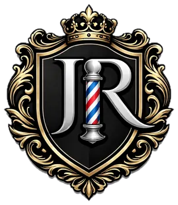
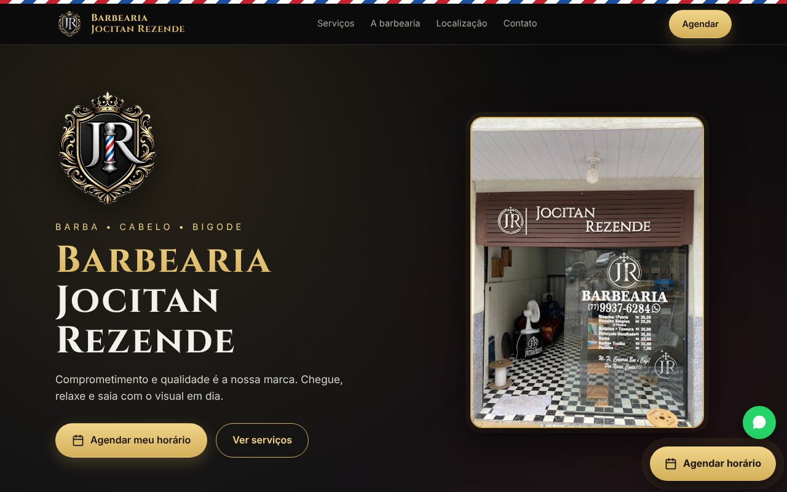
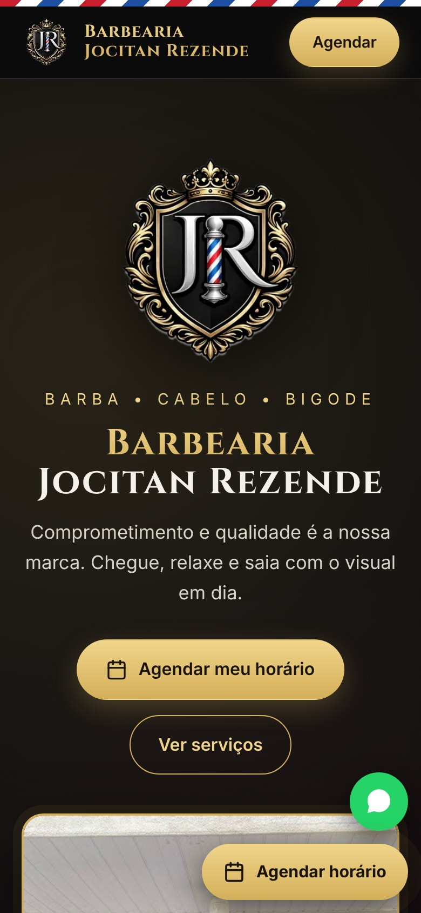
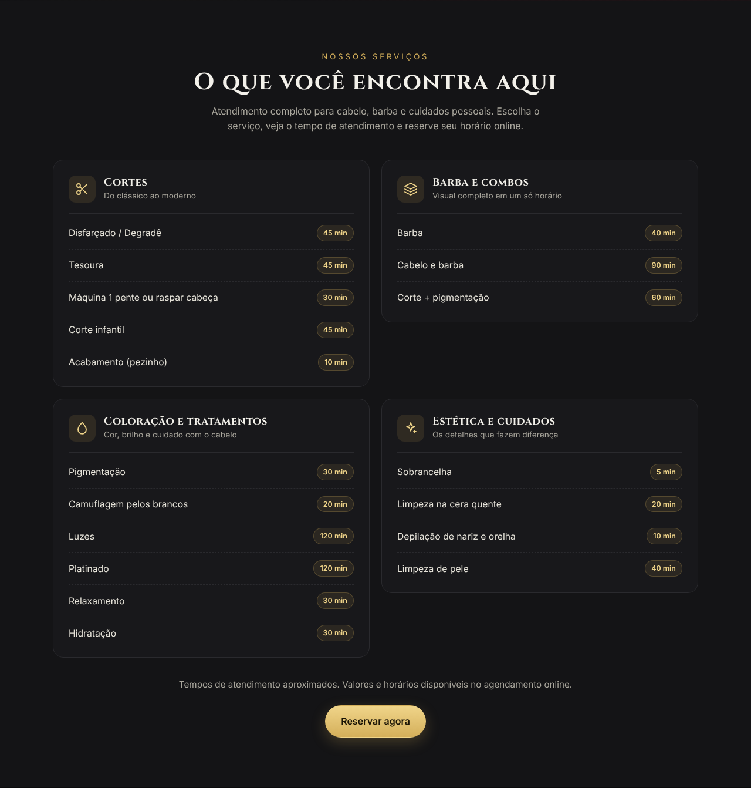
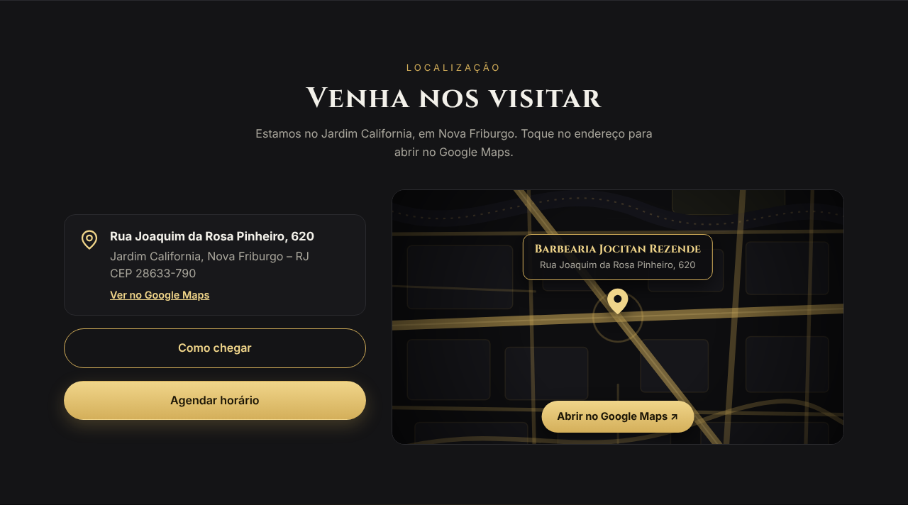

<div align="center">



# Barbearia Jocitan Rezende

**Landing page profissional para uma barbearia de Nova Friburgo – RJ**

*Barba • Cabelo • Bigode — Comprometimento e qualidade é a nossa marca.*


[Agendar horário](https://agendeifacil.com/booking/7642) ·
[WhatsApp](https://wa.me/5522992347423) ·
[Instagram](https://www.instagram.com/jocitan_rezendebarbearia)

</div>

---

## Sobre o projeto

Página de apresentação criada para a **Barbearia Jocitan Rezende**. O objetivo é simples: fazer o cliente conhecer a barbearia, ver os serviços e **agendar um horário em poucos toques**, pelo celular ou pelo computador.

A identidade visual segue a logo da barbearia: fundo preto, detalhes dourados e as listras da clássica barber pole.

## Pré-visualização

<div align="center">



</div>

<table>
  <tr>
    <td width="30%" valign="top" align="center">
      <br>
      <sub><b>No celular</b></sub>
    </td>
    <td width="70%" valign="top" align="center">
      <br>
      <sub><b>Serviços organizados por categoria</b></sub><br><br>
      <br>
      <sub><b>Localização com endereço clicável</b></sub>
    </td>
  </tr>
</table>

## Funcionalidades

- **Agendamento em um toque:** botão flutuante "Agendar horário", sempre visível, ligado ao [Agendei Fácil](https://agendeifacil.com/booking/7642).
- **WhatsApp direto:** botão flutuante e seção de contato com mensagem já preenchida, para quem quer combinar um trabalho mais detalhado.
- **Serviços por categoria:** Cortes, Barba e combos, Coloração e tratamentos, e Estética e cuidados, com o tempo de cada atendimento. Os valores ficam no agendamento online.
- **Localização clara:** endereço clicável que abre a ficha da barbearia no Google Maps, botão "Como chegar" e mapa ilustrado nas cores da marca.
- **Identidade da marca:** logo, fachada real da barbearia e ícone próprio na aba do navegador.
- **Responsivo de verdade:** testado de 320 px (celulares pequenos) a 1440 px (telas grandes), sem rolagem lateral.
- **Acessível:** textos alternativos nas imagens, rótulos nos links e animações reduzidas para quem prefere menos movimento.

## Decisões de projeto

| Decisão | Por quê |
|---|---|
| **Site estático, sem framework** | Carrega rápido, não precisa de build e é simples de manter e hospedar. |
| **Mapa ilustrado em SVG** | O mapa embutido do Google era bloqueado no site publicado. A ilustração sempre carrega, combina com a marca e leva ao Google Maps real com um toque. |
| **Agendamento fora do site** | O Agendei Fácil já cuida de horários e valores. A página só leva o cliente até ele, sem duplicar informação. |
| **Foto da fachada enquadrada** | A foto é pequena. Em vez de esticá-la como fundo, ela aparece com moldura dourada e fica nítida. |

## Tecnologias

| Para quê | O que foi usado |
|---|---|
| Estrutura | HTML5 semântico |
| Estilo e layout | CSS3 (Grid, Flexbox, variáveis CSS, animações) |
| Interações | JavaScript puro |
| Ilustração do mapa e ícones | SVG |
| Fontes | Google Fonts: Cinzel e Inter |
| Agendamento | Agendei Fácil |
| Contato | WhatsApp (`wa.me`) |

## Estrutura do projeto

```
├── index.html             # página completa (HTML + CSS + JS)
├── logo.png               # logo da barbearia
├── fachada.jpg            # foto da fachada
├── favicon.ico            # ícone da aba do navegador
├── favicon-32.png
├── favicon-48.png
├── apple-touch-icon.png   # ícone ao salvar na tela inicial do iPhone
├── icon-192.png
├── icon-512.png
└── docs/                  # imagens usadas neste README
```

## Como rodar

Não há nada para instalar. Abra o `index.html` no navegador. Se preferir um servidor local:

```bash
npx serve .
```

## Como publicar

**Pelo GitHub, com publicação automática a cada commit**

1. Na [Vercel](https://vercel.com), escolha **Add New → Project** e importe este repositório.
2. Em **Framework Preset**, deixe **Other**. Não é preciso Build Command nem Output Directory.
3. Clique em **Deploy**.

Netlify e Cloudflare Pages funcionam da mesma forma.

**Arrastando a pasta:** acesse [vercel.com/drop](https://vercel.com/drop) e arraste os arquivos do projeto.

## Como personalizar

Procure estes trechos no `index.html`:

| O que mudar | Onde |
|---|---|
| Link de agendamento | `https://agendeifacil.com/booking/7642` |
| Número do WhatsApp | `5522992347423` |
| Endereço e mapa | seção `#local` |
| Serviços | seção `#servicos` |
| Instagram | `instagram.com/jocitan_rezendebarbearia` |
| Cores da marca | variáveis no topo do `<style>` (`--gold`, `--bg` e outras) |

## Contato da barbearia

- **Endereço:** Rua Joaquim da Rosa Pinheiro, 620 – Jardim California, Nova Friburgo – RJ, CEP 28633-790
- **WhatsApp:** (22) 99234-7423
- **Instagram:** [@jocitan_rezendebarbearia](https://www.instagram.com/jocitan_rezendebarbearia)
- **Agendamento:** [agendeifacil.com/booking/7642](https://agendeifacil.com/booking/7642)

## Créditos

Site desenvolvido por [VCRK Digital](https://www.instagram.com/vcrk.digital).

Logo, fotos e nome da Barbearia Jocitan Rezende pertencem aos seus respectivos proprietários.
